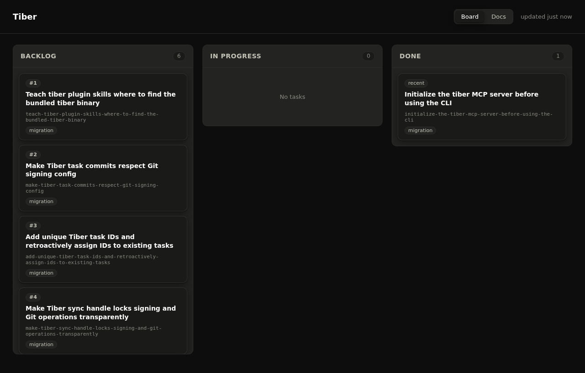
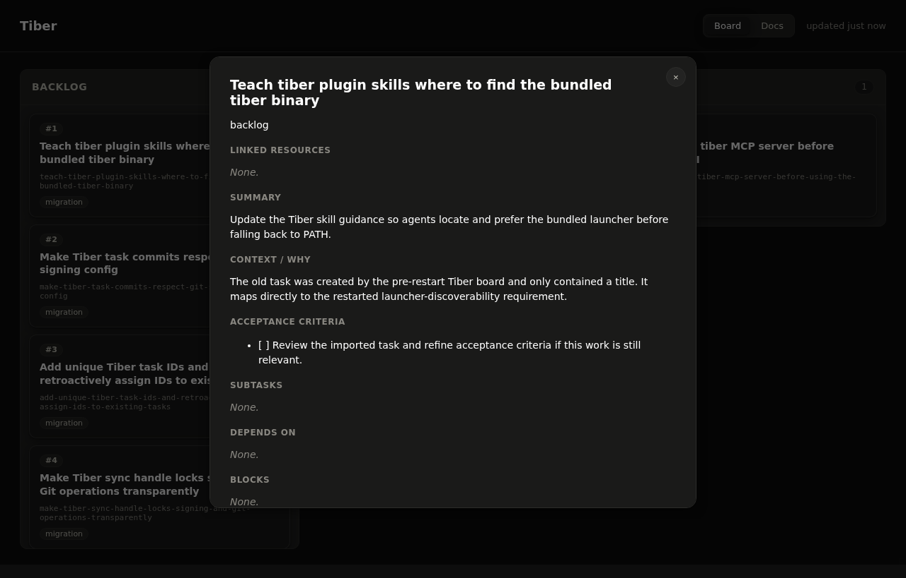
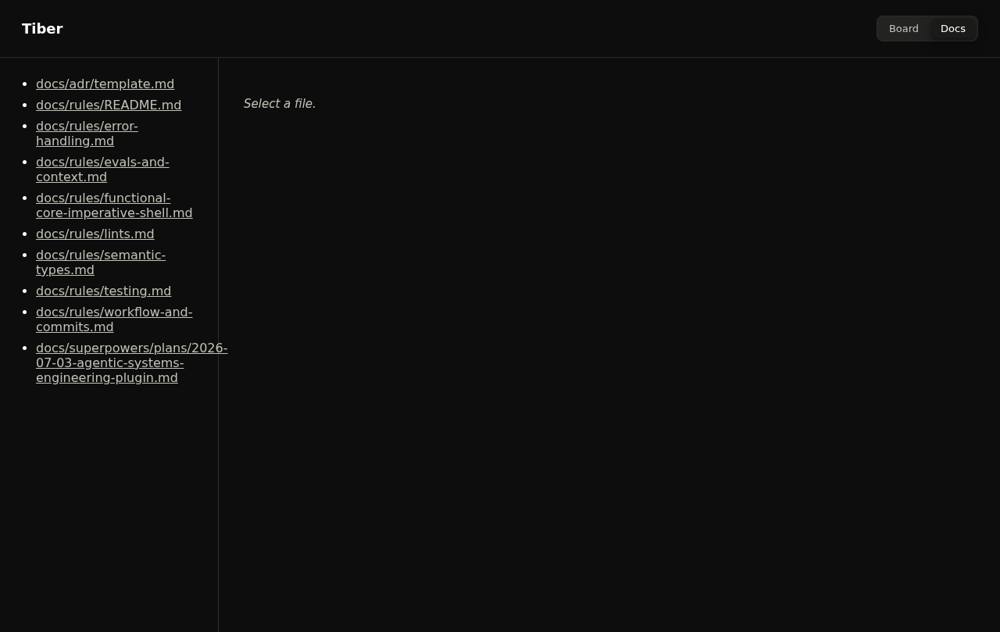

# Tiber

Tiber is an event-sourced task board for coding agents. It keeps task and
CI-recovery state in an EventCore/eventcore-fs store on one dedicated orphan
`tiber` branch and gives agents a deterministic CLI plus stdio MCP tools.

The goal is simple: multiple agents and worktrees can coordinate through one
authoritative event history instead of repository ticket files.

## Screenshots

These screenshots were captured from this repository after initializing Tiber and
creating the top-level tasks for the rename/merge work.







## Installation

Install the independent plugin with `codex plugin add tiber@ai-plugins` after
adding this marketplace. The repository's `install.sh` installs Tiber and
Development System together by default. Tiber needs no `.development-system.toml`;
its optional project configuration is `.tiber.toml`.

Resolve `bin/tiber` from the installed plugin root. The launcher repairs only
Tiber's own versioned binary cache. Linux x86_64 uses the checksum-verified
release; other hosts require Cargo and a verified exact-release source bundle.
On first installed portable MCP startup, Tiber configures one shared user-level
Codex transport that forwards `SSH_AUTH_SOCK` by name. The installer can also
bootstrap it immediately. A stable dispatcher in `PLUGIN_DATA` resolves the
currently enabled installed Tiber launcher on each launch, so future Tiber
upgrades require no installer rerun, even when Codex removes the old cache. Existing task history and Git refs require no migration.

### SSH authentication and existing installations

Codex 0.166.0 filters `SSH_AUTH_SOCK` from ordinary MCP environments. Portable
plugin `mcp.json` does not support `env_vars`, and `${SSH_AUTH_SOCK}` and
`$SSH_AUTH_SOCK` in `env` remain literal strings. A saved socket path can become
stale after login or agent restart. This also affects SSH Git fetch/push;
sandbox access alone cannot restore missing agent credentials.

Fresh plugin-only installations bootstrap automatically on their first MCP
startup. Fully restart Codex once after that bootstrap to activate forwarding.
For existing 1.1.x versioned registrations, migrate once using the current
installed helper below or the shared installer. An already deleted old command
cannot repair itself. This one-time migration repairs all caller projects:

```shell
curl -fsSL https://raw.githubusercontent.com/jwilger/ai-plugins/main/install.sh | sh
```

Then fully restart Codex from a shell where the current SSH agent is available.
After agent rotation, restart Codex again from the updated environment. Restarting
only MCP inside an already running Codex process cannot refresh its parent
environment. No private keys or session socket paths are stored by this repair.
HTTPS and unsigned repositories can run with `SSH_AUTH_SOCK` unset; repositories
that require SSH authentication or signing still need usable credentials.

For an already installed current release, run
`python3 /absolute/installed/tiber/scripts/configure-codex-mcp.py` to check, or
append `--apply` to repair. Use the actual installed cache root, never a repository
copy. The helper preserves unrelated configuration and refuses an unmanaged
Tiber registration or a symlinked config. Review that registration rather than
replacing it automatically. Do not run competing config writers during repair.
Python 3.11 or later is required for the helper.

A supported direct registration in the user-level Codex `config.toml` is:

```toml
[mcp_servers.tiber]
command = "/absolute/trusted/installed/tiber"
args = ["mcp", "stdio"]
env_vars = ["SSH_AUTH_SOCK"]
env = { TIBER_AGENT_FORWARDING = "current-session" }
```

Use an absolute trusted installed native executable, or the installed plugin's
`bin/tiber` launcher with explicit `PLUGIN_ROOT` and `PLUGIN_DATA` in `env`.
The helper instead provisions a stable dispatcher, captures an absolute trusted
Codex CLI path and supplies `PLUGIN_DATA`; the dispatcher sets the selected
`PLUGIN_ROOT` at launch. It queries Codex inventory from a neutral directory
without forwarding the agent to that subprocess. Disabled or uninstalled Tiber
fails safely. Runtime PATH replacements are ignored. If the captured Codex
executable disappears after a Codex upgrade, rerun the installed helper with
the current trusted Codex available. Normal Tiber CLI calls never change global
MCP configuration. Bootstrap diagnostics go to stderr. A complete same-name
user declaration replaces the plugin transport; a partial `env_vars` overlay
is invalid and does not retain plugin environment or working directory. Keep
unrelated existing `env_vars` when repairing a user-owned direct registration.
Never forward an agent to a PATH-resolved or project-controlled executable.
Never copy keys, source shell startup files, discover arbitrary sockets, or
hardcode a session socket in the MCP configuration.

Legacy plugin-only launchers can still read `signing-agent-socket` for
compatibility, but that snapshot cannot follow socket changes. Current-session
mode ignores it, including when the parent agent is unset. After the one-time
stable-dispatcher bootstrap, Tiber upgrades need no installer repair. Agent
rotation still requires a full new Codex process from the current agent shell.
`tiber.ssh_authentication_failed source_redacted=true` reports a known SSH public-key
rejection with safe repair guidance; it does not expose Git stderr or remotes.
For a PATH command, preview `tiber install-bin --target-dir ~/.local/bin --dry-run`.
The installer never overwrites an existing forwarder. When upgrading a legacy
Development System forwarder, inspect its printed destination, move that old
file to a backup, then explicitly run `--apply` using the new Tiber launcher.
Do not remove an unrelated executable or silently replace a user's forwarder.

## Quick Start

```shell
tiber init
tiber create "Document release checklist"
tiber list
tiber list --status done
tiber search "release checklist"
tiber show document-release-checklist
tiber validate --fix
tiber sync
```

`tiber init` is explicit. Installing the plugin or starting an agent session does
not mutate the repository.

Tiber task reads and writes also work from a coordination-only primary checkout
when Git cannot report a normal worktree but the repository declares its source
root through `core.worktree`. Relative values are resolved from the Git
directory. A true bare repository or another context without an explicit
worktree root is refused with actionable repository-context guidance.

For Codex sandboxed sessions, preview the narrow host-access setup before
granting broad permissions:

```shell
tiber codex-sandbox --dry-run
```

The preview treats raw Git prefix approvals as case-by-case, including
`hash-object`, `mktree`, `commit-tree -S`, `update-ref`, fetch, and push.
Persist approval only when the harness can scope it to the exact Tiber-internal
operation rather than a reusable raw `git` prefix. Prefer the narrowest approval
that lets the same structured Tiber MCP operation be retried. Do not run the
whole Tiber MCP server outside the sandbox unless the narrow Git permissions are
insufficient.

When you start working on an existing task, move it out of the backlog first:

```shell
tiber transition <task-ref> in-progress
```

Backlog tasks are unclaimed work, not informal reservations.

## What Tiber Stores

- `tiber` is an orphan Git branch containing the eventcore-fs event store.
- Semantic task and CI-recovery events share that store in separate EventCore
  streams and use expected stream versions for optimistic concurrency.
- A command is successful only after its exact event transaction is published
  to `origin/tiber` when an origin exists.
- CLI and MCP commands accept a task id, nickname, or full stem. Users do not
  need to know stream identifiers or EventCore storage details.

This keeps task state versioned, syncable, and separate from the source branch.
Inspect it through `tiber show`, `tiber list`, or the dashboard.

Bare `tiber list` preserves board-order output for open work. Use
`tiber list --status <backlog|in-progress|done|abandoned>` to inspect one
lifecycle state. Use `tiber search "<query>"` to search titles, summaries, and
context across every state; it returns deterministic JSON containing each
matching task's `id`, `status`, `title`, `summary`, and `context`. The
`tiber.search` MCP tool exposes the same results as structured content.

## Backlog Capacity

Projects may set a maximum queued backlog in the repository-owned
`.tiber.toml`:

```toml
[backlog]
max_queued = 5
```

Only tasks in `backlog` count. The active `in-progress` task and tasks in
`done` or `abandoned` do not. Tiber enforces the limit when creating a task,
reopening completed or abandoned work into `backlog`, or moving active work
back into `backlog`. CLI and stdio MCP calls use the same enforcement. The
dashboard exposes no admission route; backlog priority reordering is
count-neutral.

When the queue is full, Tiber refuses before persisting the admission and
reports the current count and limit. Choose one explicit outcome: replace a
lower-value queued task, combine genuinely overlapping work, or reject the
candidate. Do not retry unchanged, raise the limit merely to fit work, or keep
an overflow, icebox, shadow, or hidden backlog.

Existing projects require no migration: a missing `.tiber.toml` or omitted
`max_queued` setting means unlimited capacity. Adding a limit to an already
over-capacity project does not block moves out of `backlog`; reduce the queue
before admitting more work. Invalid configuration fails closed for admission
operations. Fix or remove `.tiber.toml` to recover; removing the setting rolls
back to unlimited capacity.

The replenishment review threshold remains an operating-procedure concern,
not Tiber configuration. It triggers judgment about whether to look for
candidates and does not define a storage invariant, so Tiber mechanically
enforces only the maximum queued count.

## Final-Review Completion Policy

Projects can opt into a mechanical completion and delivery gate in the
repository-owned `.tiber.toml`:

```toml
[final_review]
minimum_clean_reviews = 3
```

When enabled, `tiber transition <task-ref> done` and
`tiber close-from-trailers` refuse to close an implementation task until its
authoritative Tiber event history contains the configured number of consecutive
clean reviews. Every review in the final configured sequence must use the
`independent-final-review` reviewer type, have a distinct review and reviewer
identity, and agree on the declared Git pathspec scope, commit range, source
fingerprint, and verification-evidence scope and fingerprint. Tiber resolves
the supplied commit-range endpoints to full commit OIDs and computes both
fingerprints itself. Reviews use the canonical `tiber-final-review-scope-v5`
path manifest, which binds each materialized path, Git mode, entry kind, and
exact bytes (or gitlink OID) without binding the staging partition. Completion
and delivery resolve a full commit OID and tree OID once, recompute both scopes
from that immutable tree, and persist those OIDs with the completion event.
The retained requested pathspecs are rematerialized against that selected tree,
so newly committed matching paths invalidate the clean sequence while retained
literal deleted paths remain part of the manifest.

Record every clean review and every review with a substantive finding through
the CLI or the provider-neutral `tiber.review.record` MCP tool:

```shell
tiber review <task-ref> \
  --review-id review-3 \
  --reviewer reviewer-session-3 \
  --reviewer-type independent-final-review \
  --scope 'src/**' \
  --scope 'tests/**' \
  --commit-range base-oid..head-oid \
  --outcome clean \
  --evidence receipt-or-report-reference \
  --timestamp 2026-08-27T12:00:00Z \
  --source-fingerprint auto \
  --verification-scope .tiber-verification/final-review.txt \
  --verification-fingerprint auto
```

Each record durably includes its identity, reviewer identity and type, the
materialized exact path inventory selected by the requested scope,
commit range, outcome, evidence, timestamp, source fingerprint, verification
scope, and verification fingerprint. Requested scope values are repeated
pathspec arguments, so paths containing spaces remain exact. Tiber resolves
those pathspecs when the review is recorded and retains literal entries for
deleted paths, allowing a content-identical staging and commit step to preserve
the reviewed receipt. Empty scopes and unresolved commit ranges are rejected.
Source fingerprints bind working-tree contents and Git modes. Moving identical
content between unstaged, staged, and committed partitions is metadata-only,
but policy-enabled completion requires every reviewed source and verification
receipt to be represented by the selected commit tree. An uncommitted reviewed
path is rejected with `source_not_committed` or `verification_not_committed`;
commit it and record fresh reviews if the committed snapshot differs. A finding clears
the effective clean sequence. A later record with a changed scope, commit range, source fingerprint,
verification scope, or verification fingerprint also starts a new sequence;
this covers scope expansion and changed relevant verification evidence. Source
or verification mutation after the latest clean review is detected when
completion or trailer-driven delivery is attempted. Refusals name the exact
missing count, independence condition, or stale evidence condition.

Immutable-tree evaluation uses a disposable index loaded only from the selected
tree, pins attribute pathspec evaluation to that same tree, uses one bounded
tree listing, and performs one batched blob read into a single retained buffer.
Attribute-magic pathspecs require Git 2.41 or newer. Tiber probes that capability
before immutable evaluation and fails closed with
`attribute_source_unsupported` plus the upgrade-and-rereview action when the
host Git cannot bind attributes to the selected tree.
Identical source or verification scopes are cached across tasks in one
trailer-delivery command; Git subprocess count is therefore constant per
distinct uncached scope rather than proportional to its file count.

Fingerprinting fails closed with a `scope_too_large` diagnostic when one Git
enumeration exceeds 16 MiB, the combined scope exceeds 100,000 paths, or the
selected regular-file content exceeds 64 MiB. Narrow the declared scope and
record fresh independent reviews rather than bypassing those limits. A single
trailer-delivery command reuses identical source and verification fingerprints
across its referenced tasks while retaining at most 256 distinct fingerprint
entries and evicting the least recently reused entry when the cache is full.

There is no runtime bypass flag. To opt out deliberately, remove the
`[final_review]` table (or set `minimum_clean_reviews = 0`) in a reviewed,
committed project configuration change. Completion and delivery evaluate the
committed policy and reject an uncommitted policy change. That Git-visible change is the audit
record; ordinary CLI, MCP, local completion, and trailer-driven CI delivery
cannot silently bypass an enabled policy. Explicit nonzero minima one and two
are supported; larger configured minima remain enforced. The committed policy,
independence, source/verification fingerprints, and trailer gate remain mandatory.

Existing projects remain opted out after upgrade because a missing table
defaults to zero. Existing Tiber event histories need no migration: review
fields and completion-snapshot fields on older events default to empty during
replay. Historical v4 review fingerprints remain readable but cannot authorize
a new policy-enabled completion; Tiber reports `fingerprint_version_legacy`
and requires fresh v5 reviews. Source and verification receipts must be
committed before completion (a future explicitly supported immutable external
receipt may provide another durable representation).
Enabling the policy does not grandfather open or completed work: each task must
acquire fresh qualifying records before completion or later trailer-driven
delivery. Disabling and later re-enabling the policy does not erase review
history, but only the current consecutive sequence can satisfy the gate.

## New Task Skill

The plugin includes the manually invokable `tiber:new-task` skill for quick
backlog capture from an agent session:

```text
tiber:new-task Document release checklist
```

The skill creates the task through structured Tiber MCP tools, records any
obvious summary or acceptance details from the prompt, runs the structured Tiber
MCP validation tool, and leaves the task in `backlog` unless the user explicitly
asks to start work immediately.

It relies only on structured Tiber MCP tools for creation, validation, and
backlog handling. It does not fall back to the Tiber CLI, direct file edits, or
shell commands.

## CLI Commands

Run `tiber --help` for the complete command list and
`tiber <command> --help` for parser-generated command usage. Generated help is
the authoritative CLI grammar.

Common reads:

```shell
tiber list
tiber next
tiber show <task-ref>
tiber metadata <task-ref>
```

Common writes:

```shell
tiber create "Task title"
tiber transition <task-ref> <status>
tiber prioritize <task-ref> --before <task-ref>
tiber link <task-ref> blocks <task-ref>
tiber unlink <task-ref> blocks <task-ref>
tiber subtask add <task-ref> "Subtask title"
tiber subtask add <task-ref> "Dependent subtask" --after s1,s2
tiber subtask check <task-ref> s1
tiber subtask uncheck <task-ref> s1
tiber update <task-ref> --summary "New summary" --tags infra,docs
tiber update <task-ref> --pr-mr-url https://github.com/org/repo/pull/42 --pr-mr-status checks-pending
tiber acceptance add <task-ref> "Observable condition"
tiber acceptance check <task-ref> 1
tiber note add <task-ref> "Progress note"
```

Summary and context values may contain actual line breaks. Tiber preserves those
line breaks and literal backslashes exactly across CLI and MCP updates; callers
do not need to flatten multiline text or replace it with literal `\n` sequences.
Unsupported control characters and embedded headings reserved by Tiber's task
schema fail with actionable diagnostics before the ticket or board is changed.

Validation and integration:

```shell
tiber validate --fix
tiber close-from-trailers
tiber codex-sandbox --dry-run
tiber install-bin --target-dir ~/.local/bin --dry-run
tiber scaffold repo --dry-run
tiber scaffold repo --apply
```

`install-bin` is dry-run-first. The dry run reports the target command and
bundled launcher without writing either path. Re-run it with `--apply` to
install an executable forwarder that invokes the bundled Tiber launcher from
any working directory:

```shell
tiber install-bin --target-dir ~/.local/bin --apply
tiber --help
```

The apply step never replaces an existing `tiber` file or symlink. Remove or
relocate an existing target deliberately before reinstalling or upgrading.

`validate --fix` only performs safe mechanical repairs such as misplaced claims
and missing reciprocal links. Dangling references and dependency cycles are
reported for deliberate resolution.

## Sync Model

Tiber appends semantic events through EventCore, commits eventcore-fs files to
the `tiber` branch, and pushes that branch when an `origin` remote exists.
Signed event commits retain Git's configured author and committer identity so
repository signature-verification rules can attribute them to the owner.

Confirmed concurrent publication is handled as an EventCore version conflict:
Tiber refreshes the authoritative branch and retries the pure command with its
original invocation identity. Never force-push or choose a side blindly. If
publication cannot be confirmed either way, Tiber blocks further mutations
until the pending candidate is resolved with:

```shell
tiber sync
```

Repository writes are serialized across concurrent clients. During upgrades,
current clients also hold the legacy `tiber.lock` sentinel while using their
advisory sidecar lock, so an older installed Tiber and the current version
cannot mutate the board at the same time.

`close-from-trailers` synchronizes the authoritative board before resolving
`Closes:` lines from the current `HEAD` commit. It prints `closed <task-id>` for
each published transition and exits nonzero when a requested task is missing,
invalid, conflicted, or cannot be pushed. A successful run therefore guarantees
that every task it names is no longer open.

Read commands sync before returning task data. If Tiber can merge remote task
state automatically, the read continues with the merged board. If the sync cannot
be resolved automatically, the read fails instead of returning stale or locally
divergent task data.

## CI Recovery Is Tiber-Owned

Tiber is the sole authority for pushed-CI recovery as well as task-board facts.
Its typed EventCore facts are stored on the shared Git-backed Tiber authority.
Development Discipline reads Tiber's unresolved hold only to gate delivery; it
does not keep a second incident, lease, assignment, receipt, or CI state ref.

As of 1.3.0, each MCP server has its own participant identity even when harness
session environment variables match. `logical_session` is a task label, never
shared process authority. Claim returns the current `participant` so a live
owner can transfer to a joined replacement using `to_host` and `to_session`.
If that owner has disappeared, the replacement retains the hold until the
original sixty-minute lease expires; `lease.retry_at` gives the Unix retry time.
Claim, status, and wait return `lease` with observation/expiry timestamps and
`takeover_available`. A wait spanning expiry wakes with `takeover-available`.
Explicit takeover with the current epoch, followed by ownership assertion,
is required before resuming the existing diagnosis and repair. A competing
winner requires re-reading status. No local PID check bypasses the lease.

The stored incident schema and evidence remain compatible. CLI callers retain
their explicit session identity; MCP callers must use the returned process
participant for handoff rather than treating the harness session as authority.
Clients must accept the new claim role and wait wake reason `takeover-available`
and added response fields. Null lease guidance indicates unavailable observation,
not permission to act. Epoch fencing and normal publication remain required. Ordinary recovery requires
exact successful replacement-CI proof.

To activate, update the marketplace and installed Tiber plugin to the current release, then
restart its MCP server and reload the updated tasks skill. Claim/join the
existing incident; an upgrade does not migrate or impersonate an old owner.
A live old owner may transfer explicitly, otherwise use the reported retry time
and fenced takeover. Rebuilding a checkout alone does not update an already
running installed server.

### Release an obsolete hold by explicit repository policy

As of 1.4.0, `ci-recovery release-by-policy` records a policy disposition,
not a successful repair. The current owner must supply the current epoch,
a policy reference and a concrete rationale while its lease is active. An
expired owner must explicitly take over first. No workflow name grants an
exemption, and Tiber does not infer policy authority from a filename.

```shell
tiber ci-recovery release-by-policy --incident-id ci-123 --epoch 2 \
  --policy-ref /absolute/repository/docs/workflow.md \
  --rationale "Repository policy removes this historical hold; cause remains unknown."
```

The equivalent MCP tool is `tiber.ci_recovery.release_by_policy`, with
`incident_id`, `epoch`, `policy_ref`, and `rationale`. Actor and Unix release
time are supplied by Tiber. Status reports `policy-released`,
`hold_released: true`, and `policy_release` audit metadata; wait reports the
`policy-released` state and wake reason. The `release_proof`
remains absent. Original failures, diagnosis uncertainty and event history are
retained. A subsequent distinct CI failure can open a new incident. This does
not authorize additional CI runs or relax `resolve` evidence requirements.
Upgrade the installed CLI and restart MCP before using the new operation.

## Stdio MCP

Tiber exposes the same task operations over stdio MCP:

```shell
tiber mcp stdio
```

The plugin manifest invokes its installed `bin/tiber` entrypoint directly. The
entrypoint selects the shipped native binary for the current supported target
and otherwise invokes the repository's pinned Rust build; MCP configuration
does not use a shell command string or a harness-cache fallback path.

Codex starts that entrypoint from the installed plugin root. Tiber advertises
Codex's sandbox-state metadata capability and resolves each task operation from
the active call's local `sandboxCwd`, so the authoritative board belongs to the
caller's repository rather than the plugin cache. A later call from another
workspace replaces the process-local repository selection.

Codex discovers Tiber through the plugin-root `mcp.json`. Because Codex filters
`SSH_AUTH_SOCK`, installed portable MCP startup automatically configures the
shared user-level transport described under [SSH authentication and existing installations](#ssh-authentication-and-existing-installations).
Its stable dispatcher forwards the current parent agent by variable name to
the selected enabled installed launcher, surviving removed old version caches. After agent rotation, fully restart Codex from the updated agent shell;
restarting MCP alone cannot refresh Codex's environment. Saved
`signing-agent-socket` files remain legacy compatibility only and are ignored
by the repaired current-session transport. Never pass the agent socket to a
project-controlled executable.

The manifest's `./bin/tiber` command is resolved only against the installed
plugin root, never the caller checkout. Reinstall or upgrade the plugin if Codex
reports `No such file or directory`, `tiber.repository_not_found`, or one of the
`tiber.mcp_*` startup sentinel errors while using the `tiber` MCP server.

Tool names use the `tiber.*` namespace, for example `tiber.create`,
`tiber.list`, `tiber.search`, `tiber.transition`, `tiber.update`, `tiber.acceptance.add`,
`tiber.note.add`, `tiber.codex_sandbox_setup`, `tiber.install_bin`, and
`tiber.validate_fix`.

The `initialize` response also points Codex agents at
`tiber.codex_sandbox_setup` and `tasks://codex-sandbox` so sandbox setup can be
discovered through MCP before retrying a failed write.

## Dashboard

The dashboard is a browser view with count-neutral backlog priority reordering:

```shell
tiber dashboard serve --open
```

The command selects an available localhost port, prints the complete URL, and
opens it in the platform browser. A repeated launch from the same project
reports and reuses the healthy existing URL without starting another server or
opening another browser window. Different repositories keep independent
dashboard instances.

Use `tiber dashboard serve` when you only want the URL. Request a stable port
with `--port <port>` or the backwards-compatible `TIBER_DASHBOARD_PORT`
environment variable; the CLI flag takes precedence. An unavailable requested
port or invalid environment value fails clearly, and requesting a different port while that project's
dashboard is already running reports the conflict instead of starting a second
server. If the browser opener is unavailable or exits unsuccessfully, `--open`
warns but leaves the dashboard running at the printed URL.

The dashboard lets you inspect the board, reorder backlog priority, view task
files, and browse repository docs. It exposes a read-only `/events` SSE stream
for live refreshes and a count-neutral priority mutation, but intentionally has
no create, status-transition, general task-write, or `/mcp` route. Admission
changes go through the CLI or stdio MCP tools.

## Scaffold Workflow

Repository integration is dry-run first:

```shell
tiber scaffold repo --dry-run
```

The preview covers:

- a post-commit hook snippet only when the active executable hook verifiably
  dispatches it; otherwise the preview reports the missing integration
- a GitHub workflow for `tiber close-from-trailers` with pinned checkout and
  Tiber source revisions plus explicit `contents: write` permission
- an optional `just show-tasks` recipe when a `justfile` exists
- explicit `would write`, `already configured`, and `conflict` classifications;
  equivalent existing hooks and workflows suppress duplicate automation

Apply only after explicit approval of the preview:

```shell
tiber scaffold repo --apply
```

Apply refuses to overwrite a conflicting generated hook or workflow path. After
reviewing every reported conflict, explicitly choose replacement with:

```shell
tiber scaffold repo --apply --replace-conflicts
```

### Established repositories

Legacy `.tasks` trees and the former `tasks` and `tiber-coordination` branches
are ignored history, not Tiber state. Tiber neither migrates nor mutates them;
recreate any still-useful tickets manually through Tiber commands.

Scaffold resolves Git's active hooks directory. With no configured hook
dispatcher, it reports that local automation was skipped instead of writing an
inert snippet. When `core.hooksPath` selects a manager-owned directory, a
missing executable dispatcher is a blocking integration conflict; wire that
manager's active `post-commit` hook to `.githooks/post-commit.tiber`, then
preview again. Existing active task-closing hooks and push workflows remain
untouched and suppress only their matching generated integration.

The generated GitHub workflow publishes Tiber event transactions with explicit
`contents: write` permission. It pins `actions/checkout` and the Tiber source
commit rather than following mutable tags or branches, installs with the
committed Cargo lockfile, and targets the remote default branch when available
(falling back to the current branch in a repository without that remote
metadata). If local repository policy enables `commit.gpgsign`, scaffold
refuses that generated workflow before writing anything because an unattended
GitHub runner has no repository signing key. Provide repository-owned signed
publication automation and rerun the preview; do not disable signing merely to
admit the generated workflow.

## Host-local installation

Tiber owns its versioned binary installation. From the marketplace checkout,
run `plugins/tiber/scripts/install-tiber-binaries.sh` to install or repair
Tiber. The installer handles only Tiber; Development System repairs its own
executable independently. Tiber's launcher checks its installation marker and
automatically repairs a missing or stale binary before starting. Linux x86_64
uses the verified version-matched release; other hosts use the locked source
build. Pass `--from-source` to the installer for an intentional source build.

## Harness Support

Tiber targets Codex. Its plugin, CLI binary, and MCP server are named `tiber`.
Its published skills are `tiber:tasks` and `tiber:new-task`.
